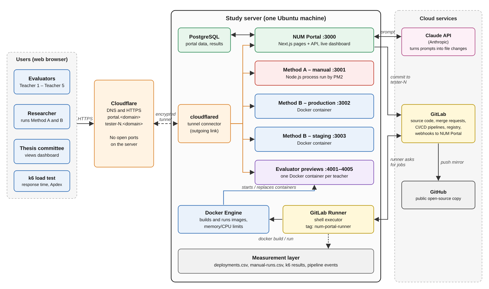
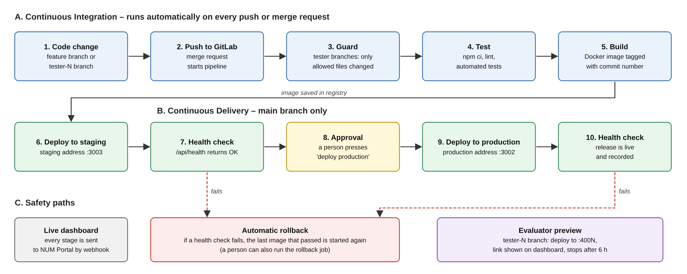

# NUM Portal

Open-source mirror: [neth-ai/num-portal](https://github.com/neth-ai/num-portal).
The included GitLab CI/CD configuration supports the deployment experiment described below.

## Local configuration

For a fresh clone, create local configuration before following the setup instructions:

```bash
mkdir -p .local-env
cp apps/num-portal/.env.example apps/num-portal/.env
cp apps/num-portal/.env.example .local-env/.env
```

Update the values for your environment. Keep real credentials in local `.env` files or
CI/CD secret variables. Environment files, `.local-env/`, dependencies, and generated
build output are excluded from Git; `.env.example` files provide configuration templates.


**Manual deployment versus DevOps – the measuring console of a master's thesis**
*“Improving Web Application Delivery in Cambodian SMEs: An Experimental Comparison of Manual Deployment
and DevOps Using GitLab CI/CD and Docker”*
(National University of Management, School of Public Policy – Digital Economy)

One change to a small business website is deployed **twice**: once by hand over SSH (Method A) and once by a
GitLab CI/CD pipeline with Docker (Method B). NUM Portal starts both releases from the same commit, records
what each method costs – deployment time, lead time, handoff waiting, manual steps, failures and recovery
time – and shows the two published websites next to each other.

The experiment is five scenarios × ten runs × two methods = **100 deployments**:
S1 first deployment, S2 feature update, S3 faulty release, S4 environment mismatch, S5 configuration change.

## Architecture

```
                    ┌───────────────────────────────────────────────┐
  researcher  ─────►│  NUM Portal  ·  Next.js 14 + PostgreSQL :3000 │
  and viewers       │  Change code · Handoff · Ops queue · Result   │
                    │  Pipelines · Compare · Statistics · Health    │
                    └────┬──────────────────────────────┬───────────┘
   one commit to         │                              ▲
   apps/sme-app/src/     │                              │  webhooks: push,
   content/page.json     │                              │  pipeline, job
                         ▼                              │
     ┌───────────────────────────────┐   ┌──────────────┴────────────────┐
     │ Method A – by hand            │   │ Method B – GitLab CI/CD       │
     │ handoff request to Operations │   │ test → build image → staging  │
     │ eleven SOP steps over SSH     │   │ → a person approves →         │
     │ pm2 restart, health check     │   │ production, rollback on red   │
     └───────────────┬───────────────┘   └──────────┬────────────────────┘
                     ▼                              ▼
              manual  :3001              staging :3003  →  devops :3002
                     └─────── the same one-page cafe website ───────┘
                                   published by Cloudflare Tunnel
```





The figure also shows a Claude API box and per-evaluator preview containers. Those belong to the
prompt-to-deploy demonstration described in the thesis; the code in this repository now covers the
deployment experiment itself.

## What is in this repository

| Path | Content |
|---|---|
| `apps/num-portal` | NUM Portal – Next.js 14 (pages + API routes), PostgreSQL via `pg`, live updates over Server-Sent Events |
| `apps/sme-app` | The cafe website that both methods deploy. One page, built from `src/content/page.json` |
| `.gitlab-ci.yml` | Method B: test → build → deploy staging → (approval) deploy production, with a manual rollback job |
| `scripts/` | `deploy.sh`, `rollback.sh` (health check and automatic rollback), `publish-site.sh` (publish locally), `manual-session.sh` (Method A timer), `server-setup.sh` |
| `docs/` | Setup guides, the manual deployment procedure, the experiment guide, the Khmer quick guide |
| `analysis/` | `analyze.py` – Tables 10–13 and the figures for Chapter V |
| `tests/` | k6 load test (Apdex) and a test of the deployment scripts |
| `infra/` | Cloudflare Tunnel configuration |

## The three deployed copies of the website

`apps/sme-app` is one page, deployed three times. Each copy serves its own content file, so Method A can be
on the old version while Method B is already on the new one – which is exactly what the **Result on the
website** page shows.

| Address | Port | Who puts a version there |
|---|---|---|
| `manual` | 3001 | Method A – a person, as the last step of the manual procedure |
| `staging` | 3003 | Method B – the pipeline, first |
| `devops` | 3002 | Method B – the pipeline, after staging is healthy and a person approves |

Before the first deployment each address answers *“Nothing is online here yet”*, which is where scenario S1
starts.

## Run everything on your own computer

Requirements: Docker. No GitLab account and no server are needed; the portal runs with an empty
`GITLAB_TOKEN` and then shows only what it has recorded itself.

```bash
echo "127.0.0.1  manual devops staging" | sudo tee -a /etc/hosts     # once
docker compose --env-file .local-env/.env up -d --build
```

| | |
|---|---|
| http://localhost:3000 | NUM Portal |
| http://manual:3001 | Method A – manual deployment |
| http://devops:3002 | Method B – production |
| http://staging:3003 | Method B – staging |

`--env-file` is needed by every `docker compose` command here: the optional `tunnel` service reads
`CLOUDFLARE_TOKEN` from `.local-env/.env` while the file is parsed. Start the tunnel as well with
`--profile tunnel`.

A deployment is one command locally:

```bash
scripts/publish-site.sh manual                    # Method A: by hand, no automatic rollback
scripts/publish-site.sh staging                   # Method B: staging first
scripts/publish-site.sh devops --auto-rollback    # Method B: production, rolls back by itself
scripts/publish-site.sh manual --rollback         # Method A: recovery, by hand again
```

It publishes `apps/sme-app/src/content/page.json` (`--source FILE` for another file), waits for
`/api/health` and appends `date,environment,action,result,seconds` to `.local-env/sites/deployments.csv`.
A faulty release (scenario S3) fails the health check: Method B puts the previous version back on its own,
Method A stays broken until a person runs the rollback – the difference the experiment measures.

Runs rehearsed this way are **not** thesis data; they are timed on a laptop.
See [docs/EXPERIMENT-GUIDE.md](docs/EXPERIMENT-GUIDE.md) §0.

### Working on the code directly

```bash
docker compose -f docker-compose.dev.yml up -d     # PostgreSQL on 127.0.0.1:5432
cd apps/num-portal
cp .env.example .env                               # set DATABASE_URL
npm ci                                             # never `npm install`: it prunes the Linux-only
npm run db:migrate                                 # optional dependencies the Docker build needs
npm run dev                                        # http://localhost:3000
```

Checks: `npm test`, `npm run lint`, `npm run build` in `apps/num-portal`; `npm run lint` and `npm run build` in `apps/sme-app` (there is no cafe unit-test script).
`bash tests/deploy-scripts/run.sh` tests `deploy.sh` and `rollback.sh` against a fake Docker command.

## Settings

Read by the portal (`apps/num-portal/src/lib/config.ts`); only `DATABASE_URL` is required.

| Setting | Purpose |
|---|---|
| `DATABASE_URL` | PostgreSQL connection string |
| `APP_VERSION` | Shown in the top bar and by `/api/health` |
| `METHOD_A_URL`, `METHOD_B_URL`, `STAGING_URL` | Where the portal checks the three sites (inside Docker: `http://manual:3000`, …) |
| `METHOD_A_PUBLIC_URL`, `METHOD_B_PUBLIC_URL`, `STAGING_PUBLIC_URL` | The same sites as the browser reaches them; embedded on the Result page |
| `SME_CONTENT_PATH`, `REPO_ROOT` | The file a release writes, and the repository it is written in |
| `GITLAB_URL`, `GITLAB_PROJECT_ID`, `GITLAB_TOKEN`, `GITLAB_DEFAULT_BRANCH`, `GITLAB_PROJECT_URL` | Method B. Without a token the portal shows only what the webhook delivered |
| `GITLAB_WEBHOOK_SECRET` | Checked on every webhook call |
| `PREVIEW_DOMAIN` | The public domain used in links |
| `PYTHON_BIN`, `ANALYZE_SCRIPT` | How the Statistics page runs `analysis/analyze.py` |

The site (`apps/sme-app`) reads `SITE_CONTENT_PATH` (which file to serve), `SITE_ENV` (the name shown at the
bottom of the page) and `APP_VERSION`.

## Setting up the study server

1. **Server** – Ubuntu 22.04/24.04: `sudo DOMAIN=yourdomain.com bash scripts/server-setup.sh`
2. **GitLab CI/CD, runner and webhook** – [docs/SETUP-GITLAB-CICD.md](docs/SETUP-GITLAB-CICD.md)
3. **Cloudflare Tunnel** – [docs/SETUP-CLOUDFLARE-TUNNEL.md](docs/SETUP-CLOUDFLARE-TUNNEL.md)
4. **Running the experiment and collecting real data** – [docs/EXPERIMENT-GUIDE.md](docs/EXPERIMENT-GUIDE.md)
5. **Manual deployment procedure (Method A)** – [docs/manual-deployment-sop.md](docs/manual-deployment-sop.md)
6. **Khmer quick guide** – [docs/SETUP-GUIDE-KM.md](docs/SETUP-GUIDE-KM.md)

### Addresses on the server (one Cloudflare Tunnel, no open ports)

| Address | Port | Purpose |
|---|---|---|
| `num-portal.<domain>` | 3000 | NUM Portal – dashboard and webhook endpoint |
| `num-portal-manual.<domain>` | 3001 | Method A – manual deployment with PM2 |
| `num-portal-devops.<domain>` | 3002 | Method B – production container |
| `num-portal-staging.<domain>` | 3003 | Method B – staging container |

## Analysis

```bash
python3 -m venv .venv && . .venv/bin/activate
pip install -r analysis/requirements.txt
python analysis/analyze.py experiment-runs.csv --apdex-a k6-manual.json --apdex-b k6-devops.json
```

`analysis/output/report.md` holds Tables 10–13 with test names, p-values and effect sizes.
`analysis/sample-data/DUMMY-experiment-runs.csv` is **invented data** for checking that the script runs –
never report numbers from it.

## License

MIT – see [LICENSE](LICENSE). © 2026 Nan Neth.

## Branch and release workflow

Use `dev/* -> staging -> main`. `staging` is the shared integration branch; `main` holds production releases. Prefer a short-lived branch per change, such as `dev/neth/fix-health`, as the team grows. `dev/neth` is the initial working branch.

| Event | Checks and deployment |
|---|---|
| Push `dev/*` | Portal lint, 22 unit tests and production build; cafe lint and production build |
| Merge request `dev/* -> staging` | Same checks plus branch promotion policy; no deployment |
| Merge into `staging` | Checks, publish both Docker images, deploy cafe staging automatically |
| Merge request `staging -> main` | Same checks and branch policy; no deployment |
| Merge into `main` | Checks, publish both images, manual cafe production deployment and optional portal deployment |

Use merge requests and merge commits for promotion. Merge only reviewed changes with passing pipelines; do not merge every developer branch automatically. Keep `staging` after a release. The pipeline avoids duplicate dev push/MR pipelines. Main rebuilds images from its merge commit; this workflow does not promote an identical image digest across branches.

```bash
git switch dev/neth
# Edit, test and commit the change.
git push -u origin dev/neth -o merge_request.create -o merge_request.target=staging
# After staging checks and deployment succeed, create an MR from staging to main.
```

CI jobs use the local Docker executor runner and Docker Desktop. Set the runner tag to `num-portal-local` and turn off **Paused** and **Protected** so development checks can run. The runner mounts Docker Desktop's socket and provides `NUM_PORTAL_HOST_ROOT`, the absolute host repository location. Docker-in-Docker is not used. All jobs use the runner tag `num-portal-local`.

Staging deploys to the existing Compose `staging` service on port 3003. Production deploys to `devops` on port 3002 after approval; the optional portal job updates `portal` on port 3000. Deployments preserve Compose networking, mounts and Cloudflare routing, check health inside the container, and restore the previous image/content on failure. The host repository and `.local-env` settings must remain available. See [the GitLab setup guide](docs/SETUP-GITLAB-CICD.md).

Protect `staging` and `main`, disallow direct pushes, allow Maintainers to merge, enable **Pipelines must succeed**, and require resolved discussions. Set default branch `main`. The original Linux deployment scripts remain available for a later study-server installation, but are not used by the local pipeline.

SSH credentials permit Git push/fetch and merge request push options. GitLab API or web access is required to configure project settings, register runners, inspect private pipeline results, and approve production jobs.
